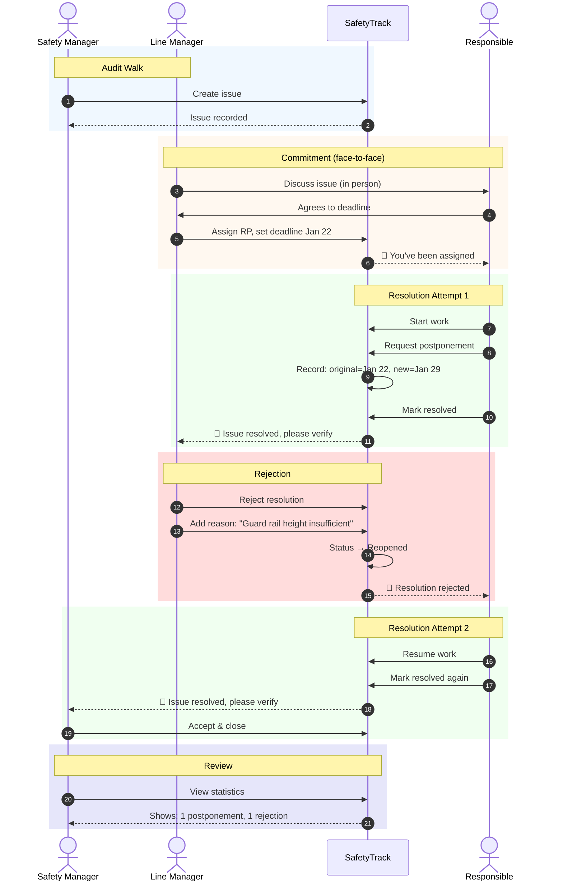
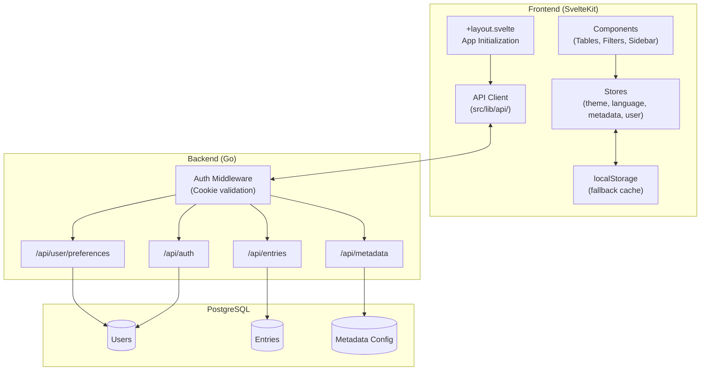
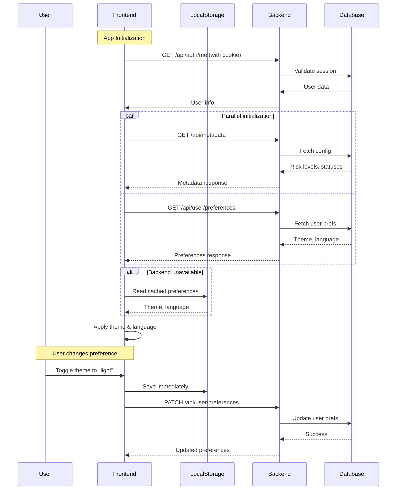
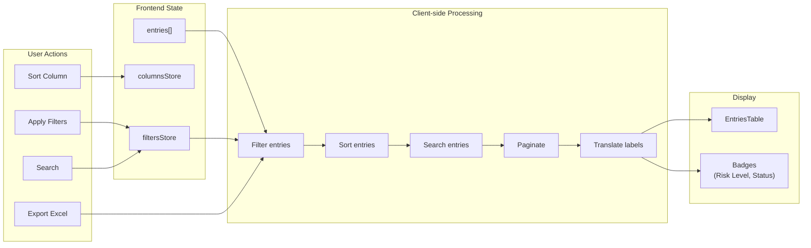

# Machinery Safety FrontEnd

## Goal

Machinery Safety is an SaaS created for companies to track the actions for potential safety risks on their production lines.

### Boundaries:
- Keep it simple
- No mobile support for now
- No multi-tenancy

### User workflow:



## Technical Setup

- PostgreSQL database
- GO backend  (https://github.com/midir99/sqload might helpful)
- RESTful API communication
- Nginx
- shadcn-svelte
- TailwindCSS
- Cookie based auth (SSO deferred)
- Metabase BI embeded for statistics
- MinIO for images
- docker containerization

## Frontend related rules

- [x] Safety issues list will need sorting, filtering, and pagination
- [x] Multi language support
- [x] Graceful handling of disconnection/cookie timeout (draft persistence via localStorage + IndexedDB)

## Logging System

The application includes an environment-aware logging system that provides comprehensive logs in development while allowing configurable log levels in production.

### Log Levels

| Level | Value | Description |
|-------|-------|-------------|
| `none` | 0 | Silent - no logs |
| `error` | 1 | Critical failures only |
| `warn` | 2 | Non-critical issues + errors |
| `info` | 3 | General information + warnings + errors |
| `debug` | 4 | Verbose logging (all levels) |

### Configuration

**Development mode:** All logs are enabled automatically (debug level).

**Production mode:** Set the `VITE_LOG_LEVEL` environment variable:

```bash
# In .env or docker-compose
VITE_LOG_LEVEL=warn  # Options: none, error, warn, info, debug
```

If not set, defaults to `warn`.

### Usage

```typescript
import { logger, apiLogger, storeLogger, uiLogger } from '$lib/utils/logger';

// Basic usage
logger.debug('Verbose debugging info');
logger.info('General information');
logger.warn('Non-critical warning');
logger.error('Critical error', errorObject);

// Pre-configured context loggers
apiLogger.warn('API request failed');     // Output: [12:34:56.789] [WARN] [API] API request failed
storeLogger.info('State updated');        // Output: [12:34:56.789] [INFO] [Store] State updated
uiLogger.error('Component error', err);   // Output: [12:34:56.789] [ERROR] [UI] Component error

// Create custom context logger
const authLogger = logger.withContext('Auth');
authLogger.info('User logged in');        // Output: [12:34:56.789] [INFO] [Auth] User logged in
```

### Available Pre-configured Loggers

| Logger | Context | Use For |
|--------|---------|---------|
| `apiLogger` | `[API]` | API requests, responses, fetch errors |
| `authLogger` | `[Auth]` | Authentication, session management |
| `storeLogger` | `[Store]` | State management, store operations |
| `uiLogger` | `[UI]` | Component errors, UI interactions |

## Pages

- [x] Login page
- [x] User dashboard
- [ ] Supervisor dashboard
- [x] New entry
- [x] View all entries
- [x] Statistics
- [ ] User settings

## Must have features

- [x] **Export all entries into excel:** available on the subheader of the view page
- [x] **Pages have icons**
- [x] **Filters on dashboard and view all entries pages**
- [x] **Column display can be adjusted by the user with a dropdown menu/checkboxes**: synced with the user account, API handling needed in the backend!

## API Documentation

### Architecture Overview



### Request Flow



### Data Flow for Entries



### Authentication Endpoints

The application uses cookie-based authentication. The backend sets an HTTP-only cookie on successful login.

**Login**

`POST /api/auth/login`

**Request Body:**
```json
{
  "username": "john.smith",
  "password": "secret123"
}
```

**Response:** `200 OK`
```json
{
  "id": "user-001",
  "username": "John Smith",
  "email": "john.smith@example.com",
  "role": "supervisor"
}
```

**Error Response:** `401 Unauthorized`
```json
{
  "error": "invalid_credentials",
  "message": "Invalid username or password"
}
```

**Logout**

`POST /api/auth/logout`

Clears the authentication cookie.

**Response:** `204 No Content`

**Get Current User**

`GET /api/auth/me`

Returns the currently authenticated user. Used to verify session validity on app initialization.

**Response:** `200 OK`
```json
{
  "id": "user-001",
  "username": "John Smith",
  "email": "john.smith@example.com",
  "role": "supervisor"
}
```

**Error Response:** `401 Unauthorized` (if not authenticated or session expired)

**Field Descriptions:**

| Field | Type | Description |
|-------|------|-------------|
| `id` | string | Unique user identifier |
| `username` | string | Display name |
| `email` | string | User's email address |
| `role` | string | User role: `worker`, `supervisor`, or `admin` |

### Metadata Endpoint

The frontend fetches dynamic configuration for dropdowns from the backend. This allows values to be changed without frontend redeployment.

**Endpoint:** `GET /api/metadata`

**Response:**
```json
{
  "riskLevels": [
    { "value": "urgent", "order": 1 },
    { "value": "high", "order": 2 },
    { "value": "medium", "order": 3 },
    { "value": "low", "order": 4 }
  ],
  "statuses": [
    { "value": "open", "order": 1 },
    { "value": "in-progress", "order": 2 },
    { "value": "completed", "order": 3 }
  ],
  "categories": [
    { "value": "mechanical", "order": 1 },
    { "value": "electrical", "order": 2 },
    { "value": "fall", "order": 3 },
    { "value": "emergency", "order": 4 },
    { "value": "lockout", "order": 5 }
  ],
  "expenseTypes": [
    { "value": "capex", "order": 1 },
    { "value": "opex", "order": 2 },
    { "value": "maintenance", "order": 3 }
  ],
  "lines": [
    { "value": "production-line-a", "order": 1 },
    { "value": "production-line-b", "order": 2 },
    { "value": "production-line-c", "order": 3 }
  ],
  "responsibles": [
    { "value": "john.smith", "name": "John Smith", "order": 1 },
    { "value": "maria.garcia", "name": "Maria Garcia", "order": 2 }
  ]
}
```

**Field descriptions:**

| Field | Type | Description |
|-------|------|-------------|
| `value` | string | **Required.** Identifier used in API calls (`lineId`, `categoryId`, `riskLevelId`, etc.). Use lowercase with hyphens for consistency (e.g., `"production-line-a"`, `"in-progress"`) |
| `order` | number | Sort order for display (ascending) |
| `name` | string | Display name (only for `responsibles`) |

**Note:** Display labels and colors are handled entirely by the frontend translation/styling system. The backend only needs to provide `value` and `order`.

**Translation fallback:** If the frontend doesn't have a translation for a value, it will capitalize and format the raw value (e.g., `"new-category"` becomes `"New Category"`).


### Database Reference Values

These are the actual values stored in the database. Use these exact strings when sending data to the backend.

#### Statuses (action_states)

| state_id | state | is_terminal | Description |
|----------|-------|-------------|-------------|
| 0 | `UNKNOWN` | false | Default/unknown state |
| 1 | `OPEN` | false | Newly created, not yet assigned |
| 2 | `ASSIGNED` | false | Assigned to responsible person |
| 3 | `IN_PROGRESS` | false | Work has started |
| 4 | `PENDING_VERIFICATION` | false | Completed, awaiting verification |
| 5 | `REJECTED` | false | Verification rejected, needs rework |
| 7 | `CLOSED` | true | Final state, issue resolved |

**Important:** Use `IN_PROGRESS` (underscore), NOT `in-progress` (hyphen).

#### Categories

| id | category_name |
|----|---------------|
| 1 | `Mechanical` |
| 2 | `Electrical` |
| 3 | `Safety` |
| 4 | `Environmental` |
| 5 | `Process` |
| 6 | `Uncategorized` |

#### Expense Types

| id | type |
|----|------|
| 1 | `CAPEX` |
| 2 | `Maintenance` |
| 3 | `OPEX` |

#### Production Lines

| line_id | line_name |
|---------|-----------|
| 1 | `BOE` |
| 2 | `BTB` |
| 3 | `BTS` |
| 4 | `Cornetto` |
| 5 | `KING` |
| 6 | `MIX` |
| 7 | `ORO-S` |
| 8 | `Palettázó` |
| 9 | `RepackA` |
| 10 | `RepackQ` |
| 11 | `Üzem` |
| 12 | `Y` |
| 13 | `Balaton` |
| 14 | `Egyéb` |

**Note:** All lookups are **case-insensitive** (e.g., `"in_progress"` and `"IN_PROGRESS"` both work).

**Behavior:**
- Called on app initialization
- If the endpoint fails or returns empty, the frontend uses hardcoded defaults
- Changes are reflected immediately after page refresh

### Adding or Changing Dropdown Values

When database values change (categories, statuses, expense types, risk levels, lines), the frontend may need updates to display them correctly.

**How it works:**
1. Backend returns dropdown options via `/api/metadata` endpoint
2. Frontend normalizes all values to **lowercase** (and replaces `_` with `-` for statuses)
3. Frontend looks up translations using the normalized value as a key
4. If no translation exists, it falls back to capitalizing the raw value

**When adding a new value to the database:**

1. **Add translation keys** (optional but recommended):

   `messages/en.json`:
   ```json
   "category_newvalue": "New Value",
   "status_newstatus": "New Status",
   "expense_newtype": "New Type",
   "riskLevel_newlevel": "New Level"
   ```

   `messages/hu.json`:
   ```json
   "category_newvalue": "Új érték",
   "status_newstatus": "Új státusz",
   "expense_newtype": "Új típus",
   "riskLevel_newlevel": "Új szint"
   ```

2. **Add translation mapping** in `src/lib/stores/metadata.svelte.ts`:

   ```typescript
   const categoryTranslations: Record<string, () => string> = {
     // ... existing
     newvalue: () => m.category_newvalue(),
   };
   ```

3. **Update default fallbacks** (optional - only needed if metadata API might fail):

   ```typescript
   const defaultCategories: CategoryOption[] = [
     // ... existing
     { value: "newvalue", order: 7 },
   ];
   ```

4. **Compile translations**: Run `bun run dev` or `bunx paraglide-js compile --project ./project.inlang`

**Naming conventions:**

| Type | DB Value | Frontend Key | Translation Key |
|------|----------|--------------|-----------------|
| Category | `"Safety"` | `"safety"` | `category_safety` |
| Status | `"IN_PROGRESS"` | `"in-progress"` | `status_inProgress` |
| Expense Type | `"CAPEX"` | `"capex"` | `expense_capex` |
| Risk Level | `"HIGH"` | `"high"` | `riskLevel_high` |

**Note:** If you skip adding translations, the frontend will display the value with automatic formatting (e.g., `"new-value"` → `"New Value"`).

### User Preferences Endpoint

User preferences (theme, language, column visibility) are synced to the backend for cross-device persistence.

**Get Preferences**

`GET /api/user/preferences`

**Response:**
```json
{
  "theme": "dark",
  "language": "en",
  "columns": {
    "id": true,
    "machine": true,
    "line": true,
    "descriptionOfDanger": true,
    "riskLevel": true,
    "action": true,
    "deadline": true,
    "status": true,
    "responsible": true,
    "riskType": false,
    "implementationDate": false,
    "moc": false,
    "createdAt": false,
    "updatedAt": false,
    "cost": false,
    "expenseType": false
  }
}
```

**Update Preferences**

`PATCH /api/user/preferences`

**Request Body:**
```json
{
  "theme": "light",
  "language": "hu",
  "columns": {
    "cost": true,
    "expenseType": true
  }
}
```

All fields are optional - only include the field(s) being updated.

**Response:**
```json
{
  "theme": "light",
  "language": "hu",
  "columns": {
    "id": true,
    "machine": true,
    "cost": true,
    "expenseType": true
  }
}
```

**Field descriptions:**

| Field | Type | Values | Description |
|-------|------|--------|-------------|
| `theme` | string | `"dark"`, `"light"` | User's preferred color theme |
| `language` | string | `"en"`, `"hu"` | User's preferred language (English or Hungarian) |
| `columns` | object | `Record<string, boolean>` | Column visibility settings for entries table (key = column name, value = visible) |

**Column Keys:**

| Key | Default Visible | Description |
|-----|-----------------|-------------|
| `id` | true | Entry ID |
| `machine` | true | Machine name |
| `line` | true | Production line |
| `descriptionOfDanger` | true | Danger description |
| `riskLevel` | true | Risk level (urgent/high/medium/low) |
| `action` | true | Required action |
| `deadline` | true | Deadline date |
| `status` | true | Current status |
| `responsible` | true | Responsible person |
| `riskType` | false | Short-term (1) or Long-term (2) |
| `implementationDate` | false | When fix was implemented |
| `moc` | false | MOC number |
| `createdAt` | false | Creation timestamp |
| `updatedAt` | false | Last modified timestamp |
| `cost` | false | Estimated cost |
| `expenseType` | false | CAPEX/OPEX/Maintenance |

**Behavior:**
- Preferences are fetched on app initialization after user login
- Changes are synced to the backend immediately when user updates theme, language, or column visibility
- Column visibility changes are debounced (500ms) before syncing to reduce API calls
- If the backend API fails, the frontend falls back to localStorage (device-specific)
- localStorage is always updated as a cache for instant response

### User Permissions

The frontend implements permission-based access control. Pages are hidden from navigation and blocked via route guards based on user permissions.

**Get User Permissions**

`GET /api/user/permissions`

Returns the authenticated user's permissions based on their role and the RBAC system.

**Response:**
```json
{
  "permissions": [
    "dashboard:view",
    "entries:view",
    "entries:create",
    "entries:edit",
    "entries:delete",
    "statistics:view",
    "supervisor_dashboard:view",
    "settings:view"
  ]
}
```

**Permission Format:** `resource:action`

| Permission | Description | Required For |
|------------|-------------|--------------|
| `dashboard:view` | View the dashboard page | `/` (home page) |
| `entries:view` | View all risk entries | `/table` page |
| `entries:create` | Create new risk entries | `/add_risk` page |
| `entries:edit` | Edit existing entries | Edit modal |
| `entries:delete` | Delete entries | Delete button |
| `statistics:view` | View statistics/Metabase | `/stats` page |
| `supervisor_dashboard:view` | View supervisor dashboard | `/supviso` page |
| `settings:view` | View settings page | `/settings` page |

**Behavior:**
- Permissions are fetched on app initialization after user login
- Navigation menu only shows pages the user has permission to access
- Direct URL access to unauthorized pages redirects to dashboard
- If the API fails, user gets minimal permissions (`dashboard:view` only)

**SQL Setup:**

```sql
-- Insert permissions
INSERT INTO permissions (permission_id, resource, action) VALUES
  (1, 'dashboard', 'view'),
  (2, 'entries', 'view'),
  (3, 'entries', 'create'),
  (4, 'entries', 'edit'),
  (5, 'entries', 'delete'),
  (6, 'statistics', 'view'),
  (7, 'supervisor_dashboard', 'view'),
  (8, 'settings', 'view'),
  (9, 'settings', 'edit');

-- Example role permissions for 'worker' role (role_id = 1)
INSERT INTO role_permissions (role_id, permission_id) VALUES
  (1, 1),  -- dashboard:view
  (1, 2),  -- entries:view
  (1, 3);  -- entries:create

-- Example role permissions for 'supervisor' role (role_id = 2)
INSERT INTO role_permissions (role_id, permission_id) VALUES
  (2, 1),  -- dashboard:view
  (2, 2),  -- entries:view
  (2, 3),  -- entries:create
  (2, 4),  -- entries:edit
  (2, 6),  -- statistics:view
  (2, 7);  -- supervisor_dashboard:view

-- Example role permissions for 'admin' role (role_id = 3)
INSERT INTO role_permissions (role_id, permission_id) VALUES
  (3, 1),  -- dashboard:view
  (3, 2),  -- entries:view
  (3, 3),  -- entries:create
  (3, 4),  -- entries:edit
  (3, 5),  -- entries:delete
  (3, 6),  -- statistics:view
  (3, 7),  -- supervisor_dashboard:view
  (3, 8),  -- settings:view
  (3, 9);  -- settings:edit
```

**Backend Implementation Notes:**

The endpoint should:
1. Get the authenticated user from the session
2. Look up the user's `role_id` from the `persons` table
3. Join `role_permissions` with `permissions` to get all permissions for that role
4. Return permissions as `resource:action` strings

Example query:
```sql
SELECT CONCAT(p.resource, ':', p.action) as permission
FROM persons per
JOIN role_permissions rp ON per.role_id = rp.role_id
JOIN permissions p ON rp.permission_id = p.permission_id
WHERE per.person_id = $1;
```

### Entry Edit Modal

The entry edit modal opens when clicking on a table row. It provides a full-featured interface for viewing and editing safety entries.

#### Modal Structure

```
┌─────────────────────────────────────────────────────────────────────┐
│ [Risk Badge]  Edit Entry #0001            [Status: Open]      [X]  │
├─────────────────────────────────────────────────────────────────────┤
│                                                                     │
│  ┌─────────────────────────────┐  ┌─────────────────────────────┐  │
│  │ MAIN FORM (2/3 width)       │  │ SIDEBAR (1/3 width)         │  │
│  │                             │  │                             │  │
│  │ ■ Basic Information         │  │ ■ Metadata                  │  │
│  │   - Line (dropdown)         │  │   - Created date            │  │
│  │   - Machine (text)          │  │   - Created by              │  │
│  │   - Category (dropdown)     │  │   - Last modified           │  │
│  │                             │  │   - Original deadline       │  │
│  │ ■ Risk Type & Linking       │  │   - Postponements           │  │
│  │   - Risk Type (toggle)      │  │   - Implementation date *   │  │
│  │   - Linked Risk (combobox)  │  │   (* shown when closed)     │  │
│  │                             │  │                             │  │
│  │ ■ Risk Details              │  │ ■ Financial                 │  │
│  │   - Description (textarea)  │  │   - Cost (number)           │  │
│  │   - Action (textarea)       │  │   - Expense Type (dropdown) │  │
│  │                             │  │   - MOC (text)              │  │
│  │ ■ Assignment & Timeline     │  │                             │  │
│  │   - Responsible (dropdown)  │  │ ■ Recent Activity           │  │
│  │   - Deadline (date)         │  │   - Timeline of changes     │  │
│  │   - Risk Level (dropdown)   │  │                             │  │
│  │   - Status (dropdown)       │  │                             │  │
│  │   - Implementation Date     │  │                             │  │
│  │                             │  │                             │  │
│  │ ■ Photo Documentation       │  │                             │  │
│  │   - Drag/drop upload zone   │  │                             │  │
│  │   - Photo preview grid      │  │                             │  │
│  │                             │  │                             │  │
│  │ ■ Comments                  │  │                             │  │
│  │   - Comment input           │  │                             │  │
│  │   - Comment list            │  │                             │  │
│  └─────────────────────────────┘  └─────────────────────────────┘  │
│                                                                     │
├─────────────────────────────────────────────────────────────────────┤
│ [Delete Issue]                              [Cancel] [Save Changes] │
└─────────────────────────────────────────────────────────────────────┘
```

#### Modal Features

- **Two-column responsive layout**: Main form (2/3) and sidebar (1/3)
- **All dropdowns are dynamic**: Values fetched from `/api/metadata` with translation support
- **Risk type toggle**: Switch between short-term (temporary) and long-term (permanent) solutions
- **Linked risk selection**: Search and link to an existing risk of the opposite type via combobox modal
- **Implementation date**: Tracks when the responsible person implemented the fix (separate from closed status)
- **Photo upload**: Drag and drop, max 5 photos, 10MB each (JPG/PNG)
- **Activity timeline**: Shows entry history (created, assigned, postponed, resolved, etc.)
- **Comments section**: Add and view discussion comments on the entry
- **Unsaved changes warning**: Prompts user before closing with unsaved changes
- **Keyboard support**: Escape key closes modal
- **Theme-aware**: Adapts to light/dark theme

### Entry CRUD Endpoints

The modal uses these endpoints for entry management:

**Get Entry**

`GET /api/entries/{id}`

Returns full entry details including photos and history. Response format follows [Backend Entry Response Format](#backend-entry-response-format).

**Update Entry**

`PATCH /api/entries/{id}`

**Request Body:**
```json
{
  "machine": "CNC Machine #5",
  "line": "Production Line A",
  "category": "mechanical",
  "descriptionOfDanger": "Missing guard",
  "action": "Install guard",
  "responsible": "John Smith",
  "deadline": "2026-02-15",
  "riskLevel": "high",
  "status": "in-progress",
  "cost": 1500,
  "expenseType": "capex",
  "moc": "MOC-2026-001",
  "riskType": 2,
  "linkedRiskId": "RS-0042",
  "implementationDate": "2026-02-10"
}
```

All fields are optional - only include fields being updated.

**New fields:**

| Field | Type | Description |
|-------|------|-------------|
| `riskType` | integer | `1` = short-term (temporary), `2` = long-term (permanent) |
| `linkedRiskId` | string \| null | ID of linked risk (must be opposite riskType) |
| `implementationDate` | string \| null | Date when the fix was implemented (YYYY-MM-DD) |

**Delete Entry**

`DELETE /api/entries/{id}`

Returns 204 No Content on success.

### Photo Upload Endpoints

**Upload Photo**

`POST /api/entries/{id}/photos`

Content-Type: `multipart/form-data`

Form field: `file` (the image file)

**Response:**
```json
{
  "id": "photo-123",
  "url": "/uploads/entries/0001/photo-123.jpg",
  "filename": "safety-issue.jpg",
  "uploadedAt": "2026-01-25T10:30:00Z"
}
```

**Delete Photo**

`DELETE /api/entries/{id}/photos/{photoId}`

Returns 204 No Content on success.

### Entry Data Model

The full Entry interface used by the frontend:

```typescript
type RiskType = 1 | 2; // 1 = short-term, 2 = long-term

interface Entry {
  id: string;
  machine: string;
  line: string;
  descriptionOfDanger: string;
  riskLevel: string;
  action: string;
  deadline: string;
  status: string;
  responsible: string;
  moc: string;
  createdAt: string;
  updatedAt: string;
  cost: number;
  // Extended fields for modal
  category: string;
  expenseType: string;
  createdBy: string;
  originalDeadline: string;
  postponements: number;
  photos: EntryPhoto[];
  history: EntryHistoryItem[];
  // Risk type and linking fields
  riskType: RiskType;
  linkedRiskId: string | null;
  linkedRisk: LinkedRiskSummary | null;
  implementationDate: string | null;
}

interface LinkedRiskSummary {
  id: string;
  machine: string;
  line: string;
  descriptionOfDanger: string;
  riskType: RiskType;
}

interface EntryPhoto {
  id: string;
  url: string;
  filename: string;
  uploadedAt: string;
}

interface EntryHistoryItem {
  id: string;
  timestamp: string;
  user: string;
  action: string;  // "created", "assigned", "postponed", "resolved", "rejected", "reopened", "updated"
  details?: string;
}
```

### Backend Entry Response Format

The backend returns entries in PascalCase with **string values only** (no redundant ID fields). The frontend maps this to the camelCase Entry interface above.

**Backend Response Example:**
```json
{
  "ID": 844,
  "RiskType": 2,
  "LinkedRiskID": null,
  "CreationDate": "2025-01-01T00:01:00Z",
  "Machines": "Töltőgép",
  "DangerDescription": "Raklapemelőhöz nincsen engedély és jogosítvány",
  "Action": "Engedély és jogosítvány intézése",
  "MOCNumber": 0,
  "Deadline": null,
  "ImplementationDate": null,
  "EntryModifiedAt": "2026-02-10T14:58:56.306397Z",
  "CommittedAt": null,
  "Cost": 100,
  "ExpenseType": "CAPEX",
  "Line": "ORO-S",
  "Category": "Uncategorized",
  "RiskLevel": "high",
  "State": "OPEN",
  "Responsible": "Medve Gergő",
  "CreatedBy": "Medve Gergő",
  "LinkedRisk": null,
  "Photos": null,
  "StatusHistory": [
    {
      "ID": "hist-001",
      "Timestamp": "2025-01-01T00:01:00Z",
      "User": "Medve Gergő",
      "Action": "created"
    },
    {
      "ID": "hist-002",
      "Timestamp": "2025-01-05T10:30:00Z",
      "User": "John Smith",
      "Action": "assigned",
      "Details": "Assigned to Maria Garcia"
    }
  ],
  "DeadlineHistory": [
    {
      "ID": "hist-003",
      "Timestamp": "2025-01-15T14:00:00Z",
      "User": "Maria Garcia",
      "Action": "postponed",
      "Details": "from 2025-01-20 to 2025-01-27"
    }
  ]
}
```

**Field Mapping Rules:**

| Backend Field | Type | Frontend Field | Notes |
|---------------|------|----------------|-------|
| `ID` | number | `id` | Converted to string |
| `RiskType` | number | `riskType` | **Only field using ID** (1=short-term, 2=long-term) |
| `LinkedRiskID` | number \| null | `linkedRiskId` | Converted to string |
| `Machines` | string | `machine` | |
| `Line` | string | `line` | **String value, not ID** |
| `Category` | string | `category` | **String value, not ID** |
| `RiskLevel` | string | `riskLevel` | Lowercase (e.g., "high", "urgent") |
| `State` | string | `status` | Normalized: "OPEN" → "open", "IN_PROGRESS" → "in-progress" |
| `Responsible` | string \| null | `responsible` | Display name, **not ID** |
| `CreatedBy` | string | `createdBy` | Display name, **not ID** |
| `ExpenseType` | string \| null | `expenseType` | **String value, not ID** (e.g., "CAPEX", "OPEX") |
| `Deadline` | string \| null | `deadline` | ISO datetime, frontend extracts date only |
| `ImplementationDate` | string \| null | `implementationDate` | ISO datetime, frontend extracts date only |
| `CreationDate` | string | `createdAt` | ISO datetime |
| `EntryModifiedAt` | string | `updatedAt` | ISO datetime |
| `StatusHistory` | array \| null | `history` | Combined with DeadlineHistory, sorted by timestamp descending |
| `DeadlineHistory` | array \| null | `history` | Combined with StatusHistory, sorted by timestamp descending |

**History Item Structure:**

| Backend Field | Type | Frontend Field | Notes |
|---------------|------|----------------|-------|
| `ID` | string | `id` | Unique identifier for the history item |
| `Timestamp` | string | `timestamp` | ISO datetime |
| `User` | string | `user` | Display name of user who made the change |
| `Action` | string | `action` | Lowercase: "created", "assigned", "postponed", "resolved", "rejected", "reopened", "updated", "commented" |
| `Details` | string \| undefined | `details` | Optional additional context (e.g., "from 2025-01-20 to 2025-01-27") |

**Important:** Do NOT return redundant ID fields (e.g., `LineID`, `CategoryID`, `ResponsibleID`). Return only the display values as strings.

---

## New Entry Wizard

The New Entry Wizard is a multi-step form for creating new risk entries. Located at `/add_risk`, it guides users through a 4-step process with validation, draft persistence, and risk linking capabilities.

### Wizard Flow

```
┌─────────────────────────────────────────────────────────────────────────────┐
│                           STEP INDICATOR                                     │
│    ●────────────●────────────●────────────○                                 │
│    1            2            3            4                                  │
│  Location    Risk        Assignment   Additional                             │
│  & Type      Details                  Info                                   │
└─────────────────────────────────────────────────────────────────────────────┘

Step 1: Location & Type (Required)
├── Risk Type: Short-term (1) or Long-term (2)
├── Production Line (dropdown)
├── Machine(s) Affected (text)
└── Risk Category (dropdown)

Step 2: Risk Details (Required)
├── Danger Description (textarea) *required
├── Risk Level (button group) *required
└── Required Action (textarea) *optional

Step 3: Assignment (Optional)
├── Responsible Person (dropdown)
├── Deadline (date picker, defaults to +30 days)
└── Status: Always "open" for new entries (read-only)

Step 4: Additional Info (Optional)
├── Linked Risk (search modal - links to opposite type)
├── Estimated Cost (number)
├── Expense Type (dropdown)
├── MOC Number (text)
└── Photos (drag & drop, max 5, max 10MB each)
```

### Create Entry Endpoint

**Endpoint:** `POST /api/entries`

**Request Body:**
```json
{
  "riskType": 2,
  "linkedRiskId": "RS-0042",
  "machines": "CNC Machine #3, Assembly Robot",
  "lineId": "production-line-a",
  "categoryId": "mechanical",
  "dangerDescription": "Missing safety guard on rotating parts",
  "riskLevelId": "high",
  "action": "Install protective guard with interlock switch",
  "responsibleId": "john.smith",
  "mocNumber": "MOC-2026-001",
  "deadline": "2026-03-15",
  "cost": 2500.00,
  "expenseTypeId": "capex"
}
```

**Field Descriptions:**

| Field | Type | Required | Description |
|-------|------|----------|-------------|
| `riskType` | integer | ✓ | `1` = Short-term (temporary measure), `2` = Long-term (permanent solution) |
| `linkedRiskId` | string \| null | | ID of linked risk entry (must be opposite riskType) |
| `machines` | string | ✓ | Affected machine(s), free text |
| `lineId` | string | ✓ | Production line ID from metadata |
| `categoryId` | string | ✓ | Risk category ID from metadata |
| `dangerDescription` | string | ✓ | Description of the hazard or unsafe condition |
| `riskLevelId` | string | ✓ | Risk level: `urgent`, `high`, `medium`, `low` |
| `action` | string | | Required corrective action (optional) |
| `responsibleId` | string \| null | | User ID of responsible person |
| `mocNumber` | string \| null | | Management of Change reference number |
| `deadline` | string \| null | | ISO date string (YYYY-MM-DD) |
| `cost` | number \| null | | Estimated cost in EUR (must be >= 0) |
| `expenseTypeId` | string \| null | | `capex`, `opex`, or `maintenance` |

**Response:** `201 Created`

Returns the created entry in PascalCase format (see [Backend Entry Response Format](#backend-entry-response-format)):
```json
{
  "ID": 128,
  "RiskType": 2,
  "LinkedRiskID": 42,
  "CreationDate": "2026-02-01T10:30:00Z",
  "Machines": "CNC Machine #3, Assembly Robot",
  "DangerDescription": "Missing safety guard on rotating parts",
  "Action": "Install protective guard with interlock switch",
  "MOCNumber": null,
  "Deadline": "2026-03-15T00:00:00Z",
  "ImplementationDate": null,
  "EntryModifiedAt": "2026-02-01T10:30:00Z",
  "CommittedAt": null,
  "Cost": 2500.00,
  "Line": "Production Line A",
  "Category": "mechanical",
  "RiskLevel": "high",
  "State": "OPEN",
  "Responsible": "John Smith",
  "CreatedBy": "Safety Manager",
  "ExpenseType": "CAPEX",
  "LinkedRisk": {
    "ID": 42,
    "Machines": "CNC Machine #3",
    "Line": "Production Line A",
    "DangerDescription": "Temporary barrier installed",
    "RiskType": 1
  },
  "Photos": [],
  "StatusHistory": null,
  "DeadlineHistory": null
}
```

### Risk Type Linking Logic

Short-term and long-term risks can be linked to create pairs:

```
┌─────────────────┐         ┌─────────────────┐
│   SHORT-TERM    │◄───────►│   LONG-TERM     │
│   (riskType=1)  │  link   │   (riskType=2)  │
│                 │         │                 │
│ Temporary fix   │         │ Permanent fix   │
│ until permanent │         │                 │
│ solution ready  │         │                 │
└─────────────────┘         └─────────────────┘
```

**Linking Rules:**
- Short-term (1) can only link to Long-term (2)
- Long-term (2) can only link to Short-term (1)
- Links are bidirectional (backend should maintain both references)
- A risk can have at most one linked risk

### Search Risks for Linking

The frontend uses the existing `/api/entries` search endpoint to find linkable risks.

**Endpoint:** `GET /api/entries?search={query}&riskType={oppositeType}`

**Suggested Enhancement:** Add `riskType` filter parameter:
```
GET /api/entries?search=cnc&riskType=1
```

This would return only short-term risks when creating a long-term risk (and vice versa).

**Current Workaround:** The frontend fetches all results and expects the backend to add `riskType` filtering in the future. The `Entry` model should include `riskType` field.

### Photo Upload Flow

Photos are uploaded separately after the entry is created:

```
1. POST /api/entries              → Creates entry, returns { id: "RS-0128", ... }
2. POST /api/entries/RS-0128/photos  → Upload photo 1 (multipart/form-data)
3. POST /api/entries/RS-0128/photos  → Upload photo 2
   ... (up to 5 photos)
```

If photo uploads fail, the entry is still created. The frontend shows individual error toasts for failed uploads.

### Validation Rules

**Server-side validation should enforce:**

| Field | Validation |
|-------|------------|
| `riskType` | Must be `1` or `2` |
| `machines` | Non-empty string |
| `lineId` | Must exist in lines metadata |
| `categoryId` | Must exist in categories metadata |
| `dangerDescription` | Non-empty string |
| `riskLevelId` | Must be valid risk level (`urgent`, `high`, `medium`, `low`) |
| `responsibleId` | If provided, must be valid user ID |
| `deadline` | If provided, must be valid date format |
| `cost` | If provided, must be >= 0 |
| `expenseTypeId` | If provided, must exist in expense types metadata |
| `linkedRiskId` | If provided, must exist and be opposite riskType |

**Error Response:** `400 Bad Request`
```json
{
  "error": "validation_failed",
  "fields": {
    "machines": "required",
    "cost": "must_be_positive",
    "linkedRiskId": "must_be_opposite_type"
  }
}
```

### Draft Persistence (Frontend-Only)

The frontend automatically saves form progress to prevent data loss during network issues. This is entirely client-side and requires no backend support.

**Storage Strategy:**
- Text fields → `localStorage` (key: `risk_create_draft`)
- Image files → `IndexedDB` (database: `MachinerySafety`, store: `draft_images`)

**Auto-save Behavior:**
- Text fields: Debounced 500ms after last keystroke
- Images: Debounced 1000ms after last change
- Drafts expire after 7 days

**Draft Data Structure (localStorage):**
```json
{
  "riskType": 2,
  "linkedRiskId": null,
  "machines": "CNC Machine #3",
  "lineId": "production-line-a",
  "categoryId": "mechanical",
  "dangerDescription": "Missing safety guard",
  "riskLevelId": "high",
  "action": "",
  "responsibleId": "",
  "mocNumber": "",
  "deadline": "2026-03-03",
  "cost": null,
  "expenseTypeId": "",
  "savedAt": 1738400000000
}
```

**User Experience:**
1. User opens `/add_risk` with saved draft → Toast: "Draft restored from previous session"
2. User can click "Discard draft" to start fresh
3. On successful submission, draft is automatically cleared

### Required Entry Model Changes

The `Entry` model needs a new `riskType` field:

```typescript
interface Entry {
  // ... existing fields ...
  riskType: 1 | 2;           // NEW: 1=short-term, 2=long-term
  linkedRiskId: string | null; // NEW: ID of linked risk (opposite type)
}
```

### Database Schema Additions

```sql
ALTER TABLE entries ADD COLUMN risk_type INTEGER NOT NULL DEFAULT 2;
-- 1 = short-term (temporary measure)
-- 2 = long-term (permanent solution)

ALTER TABLE entries ADD COLUMN linked_risk_id VARCHAR(20) REFERENCES entries(id);
-- Must reference an entry with opposite risk_type

-- Constraint to ensure opposite types
ALTER TABLE entries ADD CONSTRAINT chk_linked_risk_type
  CHECK (
    linked_risk_id IS NULL OR
    (SELECT risk_type FROM entries WHERE id = linked_risk_id) != risk_type
  );
```

### Comments System

Each entry can have comments for discussion and audit trail.

**Get Comments**

`GET /api/entries/{id}/comments`

**Response:**
```json
[
  {
    "id": "comment-001",
    "riskId": "RS-0128",
    "authorId": "john.smith",
    "authorName": "John Smith",
    "content": "Ordered the guard from supplier, expected delivery next week.",
    "createdAt": "2026-02-02T14:30:00Z"
  },
  {
    "id": "comment-002",
    "riskId": "RS-0128",
    "authorId": "maria.garcia",
    "authorName": "Maria Garcia",
    "content": "Please coordinate with maintenance for installation schedule.",
    "createdAt": "2026-02-03T09:15:00Z"
  }
]
```

**Add Comment**

`POST /api/entries/{id}/comments`

**Request Body:**
```json
{
  "content": "Guard installed and tested. Requesting verification."
}
```

**Validation:**
- `content`: Required, max 500 characters

**Response:** `201 Created`
```json
{
  "id": "comment-003",
  "riskId": "RS-0128",
  "authorId": "current-user-id",
  "authorName": "Current User Name",
  "content": "Guard installed and tested. Requesting verification.",
  "createdAt": "2026-02-05T11:00:00Z"
}
```

**Comment Rules:**
- Comments are immutable (no edit/delete) for audit trail
- Ordered by `createdAt` ascending (oldest first)
- `authorId` and `authorName` derived from authenticated user

### Comment Database Schema

```sql
CREATE TABLE entry_comments (
  id VARCHAR(36) PRIMARY KEY DEFAULT gen_random_uuid(),
  risk_id VARCHAR(20) NOT NULL REFERENCES entries(id) ON DELETE CASCADE,
  author_id VARCHAR(50) NOT NULL REFERENCES users(id),
  content TEXT NOT NULL CHECK (char_length(content) <= 500),
  created_at TIMESTAMP WITH TIME ZONE NOT NULL DEFAULT NOW()
);

CREATE INDEX idx_entry_comments_risk_id ON entry_comments(risk_id);
CREATE INDEX idx_entry_comments_created_at ON entry_comments(created_at);
```

---

## Metabase Integration

The Statistics page (`/stats`) embeds Metabase dashboards for data visualization and allows users to create custom reports.

### Configuration Requirements

1. **Enable Public Sharing**: In Metabase Admin > Settings > Public Sharing, enable public sharing for dashboards
2. **Create Data Connection**: Connect Metabase to the same PostgreSQL database as the main app
3. **Create Public Dashboard**: Create a dashboard and enable public sharing to get the embed URL

### Environment Variables

Set these in the frontend deployment:

| Variable | Description | Example |
|----------|-------------|---------|
| `VITE_METABASE_URL` | Base URL of Metabase instance | `http://metabase:3000` |
| `VITE_METABASE_DASHBOARD_ID` | ID of public dashboard to embed | `1` |

### Initial Dashboards

Create these charts in Metabase and add them to a dashboard:

#### 1. Risk Level Distribution (Pie Chart)

```sql
SELECT
  risk_level,
  COUNT(*) as count
FROM entries
WHERE status != 'completed'
GROUP BY risk_level
ORDER BY
  CASE risk_level
    WHEN 'urgent' THEN 1
    WHEN 'high' THEN 2
    WHEN 'medium' THEN 3
    WHEN 'low' THEN 4
  END
```

Visualization: Pie chart with risk_level as dimension, count as metric

#### 2. Status Overview (Bar Chart)

```sql
SELECT
  status,
  COUNT(*) as count
FROM entries
GROUP BY status
ORDER BY
  CASE status
    WHEN 'open' THEN 1
    WHEN 'in-progress' THEN 2
    WHEN 'completed' THEN 3
  END
```

Visualization: Bar chart with status as X-axis, count as Y-axis

#### 3. Entries by Production Line (Horizontal Bar)

```sql
SELECT
  line,
  COUNT(*) as count,
  SUM(CASE WHEN risk_level IN ('urgent', 'high') THEN 1 ELSE 0 END) as high_risk_count
FROM entries
WHERE status != 'completed'
GROUP BY line
ORDER BY count DESC
```

#### 4. Monthly Trend (Line Chart)

```sql
SELECT
  DATE_TRUNC('month', created_at) as month,
  COUNT(*) as created,
  SUM(CASE WHEN status = 'completed' THEN 1 ELSE 0 END) as completed
FROM entries
WHERE created_at >= NOW() - INTERVAL '12 months'
GROUP BY DATE_TRUNC('month', created_at)
ORDER BY month
```

### Making Dashboard Public

1. Open the dashboard in Metabase
2. Click the share icon (or "Sharing" in menu)
3. Toggle "Enable sharing"
4. Copy the public link - the dashboard ID is in the URL (e.g., `/public/dashboard/1`)
5. Set `VITE_METABASE_DASHBOARD_ID=1` in your environment

### User Access

- **Embedded View**: All users see the dashboard embedded in the Statistics page
- **Full Access**: The "Open in Metabase" button opens Metabase in a new tab where users can create their own charts (requires Metabase user account)
## License

Copyright 2026 Ruben Zsédely

Licensed under the [Apache License, Version 2.0](LICENSE). You are free to use, modify and distribute this software, including commercially, provided that you keep the copyright and [NOTICE](NOTICE) attribution to the original author and mark any files you change.
